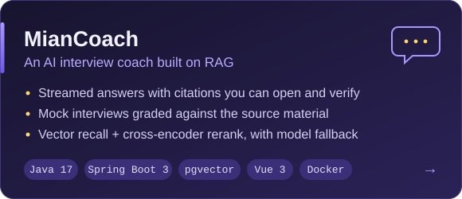
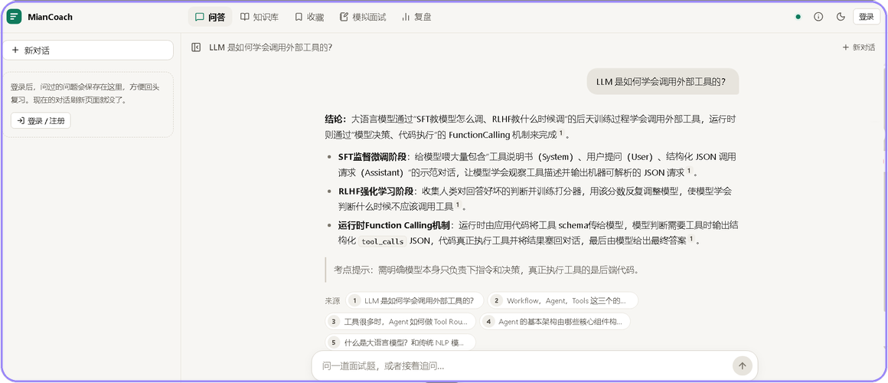
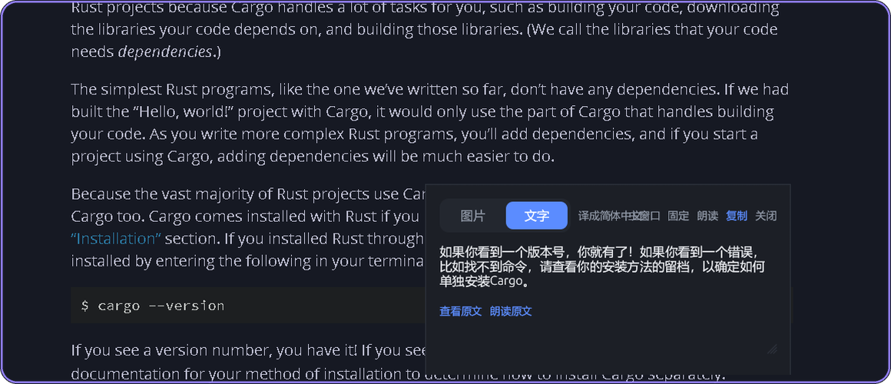
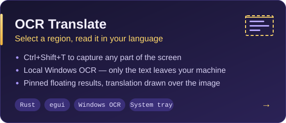
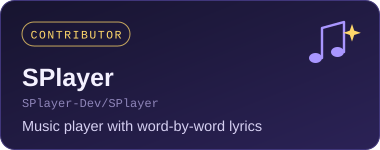
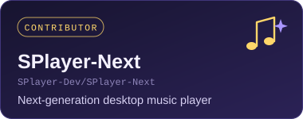
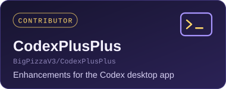

  

  <picture>
    <source media="(prefers-color-scheme: dark)" srcset="https://raw.githubusercontent.com/elaina-agi/elaina-agi/output/snake-dark.svg" />
    
  </picture>

## Projects

  
  

**[MianCoach](https://github.com/elaina-agi/miancoach)** is a RAG-based interview coach. It answers from a question bank with citations you can open, runs mock interviews, grades your answers against the source material, and tracks where you keep slipping. **Try it live at [prep.eriiagi.com](https://prep.eriiagi.com).**

  
  

**[OCR Translate](https://github.com/elaina-agi/ocr-translate)** is a small Windows tray app. Press `Ctrl+Shift+T`, drag a box over anything on screen, and the translation shows up in a floating window. OCR runs locally.

## Pulse

  

## Contributor to

  
  
  

  Tools I use every day. When something breaks, I would rather fix it than wait.

## Tech stack

| | |
| --- | --- |
| **Backend** |  |
| **Data** |  |
| **Frontend** |  |
| **Systems & tooling** |  |

## About me

- 🪄 Anime fan first, developer second. The name and the hat are borrowed from a certain wandering witch.
- 📺 I keep up with the seasonal anime lineup more faithfully than with my to-do list.
- 🎧 There is always music playing while I code, which is how I ended up fixing bugs in the music player I use.
- ⌨️ Java for the backend, Rust when I want a tool that opens instantly.

  Found a bug in one of my projects? Issues and pull requests are welcome.

  

